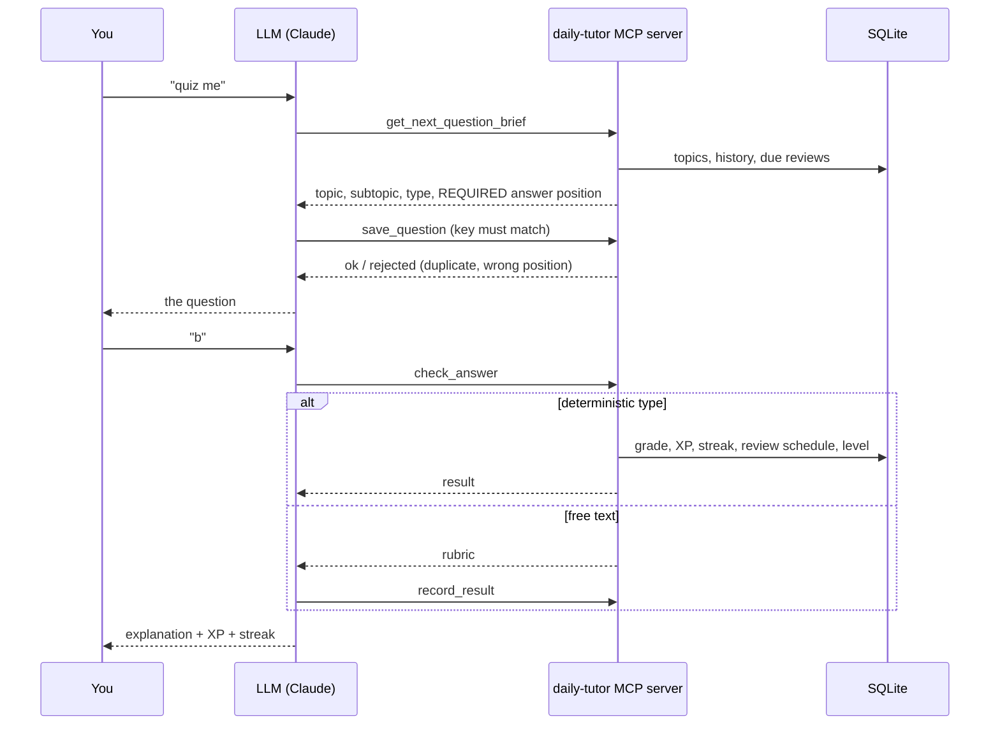

<div align="center">

# 🎓 Daily Tutor MCP

**Duolingo-style daily practice on _any_ topics you choose, as an [MCP](https://modelcontextprotocol.io) server.**
<br>Spaced repetition · adaptive difficulty · 13 question types · streaks · certification tracks

[](https://github.com/fritnes/daily-tutor-mcp/actions/workflows/ci.yml)
[](LICENSE)
[](pyproject.toml)
[](https://modelcontextprotocol.io)
[](https://github.com/fritnes/daily-tutor-mcp/pkgs/container/daily-tutor-mcp)

</div>

---

## What is this?

You tell your AI assistant what you want to learn, for example `sysadmin`, `devops`, `network engineer`, or a
certification like **CCNA** or **CKA**. Every day it asks you **one punchy, real-world question**, grades your
answer, explains it, and brings back what you got wrong at the right time.

The MCP server owns the **state and the rules**. The LLM only writes the questions and the explanations.
That split is the whole point: the things LLMs are bad at (counting, scheduling, grading, being unbiased)
are done in plain code.

```text
You   ▸ quiz me
Tutor ▸ 🚨 3 AM pager: nginx returns 502 right after a deploy. systemctl says it is running.
        Which do you check FIRST?   A) DNS   B) upstream/app logs   C) disk quota   D) cron
        (reply with one letter)
You   ▸ b
Tutor ▸ ✅ Correct! +10 XP · 🔥 4-day streak · daily goal reached
        502 = the proxy is fine, the upstream is not. Gotcha: `proxy_next_upstream` can hide a flapping backend…
```

## Features

| | |
|---|---|
| 🧠 **Multi-topic** | Any topics, each with its own level and subtopics. ~25% of questions deliberately **mix two topics** (a DNS fault that looks like a sysadmin problem). |
| 🎲 **13 question types** | Multiple choice, multi-select, true/false, fill-the-blank, command challenge, predict-the-output, troubleshooting, ordering, match pairs, spot-the-bug, explain, design trade-off, flashcard. |
| ✅ **Exact grading** | Letters, ordering, matching, true/false and accepted commands are graded **by the server**, not by the LLM. Free-text goes to the LLM with a rubric. |
| ⚖️ **No "always B" bias** | The server dictates _where_ the correct answer goes and rejects anything else. Duplicate wording and repeated concepts are rejected too. |
| 🔁 **Spaced repetition** | Missed concepts return after 1 → 3 → 7 → 14 → 30 days, from a different angle. |
| 📈 **Adaptive difficulty** | Levels go up after a strong run and down after a weak one, per topic. Lock a level any time. |
| 🏆 **Duolingo mechanics** | XP, daily goal, streaks with **freezes**, hints (half XP), skip, 5-question **sessions**, weekly recap. |
| 📜 **Certification tracks** | CCNA · CKA · RHCSA · AWS Solutions Architect Associate · Terraform Associate, with per-objective **coverage**. |
| 📚 **Your own material** | Feed it notes, runbooks or postmortems and get questions grounded in _your_ content. |
| 🔐 **Safe to host** | Authenticated HTTP transport with per-user isolation, non-root Docker image, versioned DB migrations. |

## Quick start

### Option A: Docker (recommended)

```bash
git clone https://github.com/fritnes/daily-tutor-mcp.git && cd daily-tutor-mcp
cp .env.example .env                     # then set TUTOR_API_TOKENS (openssl rand -hex 32)
docker compose up -d --build
curl -i localhost:8000/mcp               # 401 = running, auth required ✅
```

### Option B: pip

```bash
pip install git+https://github.com/fritnes/daily-tutor-mcp.git
python -m daily_tutor                    # stdio (for local clients), data in ~/.daily-tutor
```

### Option C: from source

```bash
git clone https://github.com/fritnes/daily-tutor-mcp.git && cd daily-tutor-mcp
python -m venv .venv && source .venv/bin/activate
make install && make test
```

## Connect your client

<details open>
<summary><b>Claude Desktop</b> (local, stdio)</summary>

```json
{
  "mcpServers": {
    "daily-tutor": {
      "command": "python",
      "args": ["-m", "daily_tutor"],
      "env": { "TUTOR_DATA_PATH": "/Users/me/.daily-tutor", "TUTOR_TZ": "Europe/Kyiv" }
    }
  }
}
```

Using the Docker image instead:

```json
{
  "mcpServers": {
    "daily-tutor": {
      "command": "docker",
      "args": ["run", "-i", "--rm", "-v", "daily-tutor-data:/data",
               "-e", "TUTOR_TRANSPORT=stdio", "-e", "TUTOR_TZ=Europe/Kyiv",
               "ghcr.io/fritnes/daily-tutor-mcp:latest"]
    }
  }
}
```
</details>

<details>
<summary><b>Claude Code</b></summary>

```bash
# local (stdio)
claude mcp add daily-tutor -e TUTOR_DATA_PATH=$HOME/.daily-tutor -- python -m daily_tutor

# remote (HTTP + bearer token)
claude mcp add --transport http daily-tutor https://tutor.example.com/mcp \
  --header "Authorization: Bearer <your-token>"
```
</details>

<details>
<summary><b>Any other MCP client</b></summary>

Use stdio (`python -m daily_tutor`) or Streamable HTTP at `/mcp` with an `Authorization: Bearer <token>` header.
Clients that **only** support OAuth are not supported yet (see [Roadmap](#roadmap)).
</details>

### Teach your assistant the flow

Install [`skill/SKILL.md`](skill/SKILL.md) as an agent skill. It tells the model how to run setup, ask, evaluate
and session flows, so you can simply say _"quiz me"_. For scheduled daily questions, use the built-in
`daily_question` prompt from a cron/scheduler.

## How it works



More detail in [docs/ARCHITECTURE.md](docs/ARCHITECTURE.md).

## Question types

| Type | You answer with | Graded by |
|---|---|---|
| `multiple_choice` | `B` | server |
| `multi_select` | `A,C` | server (partial credit) |
| `true_false` | `True, because …` | server verdict + LLM reason |
| `fill_blank` | the missing word(s) | server for known variants, else LLM |
| `command_challenge` | the command | server for known variants, else LLM |
| `ordering` | `3,1,4,2` | server (partial credit) |
| `match_pairs` | `A-2, B-1, C-4, D-3` | server (partial credit) |
| `predict_output` · `troubleshoot` · `spot_the_bug` · `explain` · `design_tradeoff` · `flashcard` | free text | LLM with a rubric |

## Configuration

| Variable | Default | Meaning |
|---|---|---|
| `TUTOR_DATA_PATH` | `~/.daily-tutor` (`/data` in Docker) | Folder for the SQLite database |
| `TUTOR_TZ` | system | Default IANA timezone (per-user override with `set_settings`). Decides when "today" starts |
| `TUTOR_TRANSPORT` | `stdio` (`streamable-http` in Docker) | `stdio` or `streamable-http` |
| `TUTOR_API_TOKENS` | none | **Required for HTTP.** `token:user,token:user` |
| `TUTOR_HOST` / `TUTOR_PORT` | `127.0.0.1` / `8000` | HTTP bind address |
| `TUTOR_PUBLIC_URL` | `http://localhost:8000` | Public URL when behind a proxy |
| `TUTOR_ALLOWED_HOSTS` | none | Comma-separated hostnames; enables DNS-rebinding protection |

All tools are documented in [docs/TOOLS.md](docs/TOOLS.md) (generated from the code).

## Running it for other people

- The user identity comes from the **verified bearer token**; a `user_id` argument is ignored over HTTP, so users cannot read each other's data.
- Put the container behind a TLS reverse proxy (Caddy, nginx, Traefik). `docker-compose.yml` binds to `127.0.0.1` on purpose.
- Use long random tokens: `openssl rand -hex 32`. Tokens are compared in constant time.
- The image runs as a non-root user, with a read-only root filesystem and all capabilities dropped. State lives in the `/data` volume: back it up. (If you bind-mount a host folder instead of the named volume, make it writable by UID `10001`.)

See [SECURITY.md](SECURITY.md) for the threat model and how to report a vulnerability.

## Development

```bash
make install     # editable install + pytest + ruff
make test        # 42 tests
make lint        # ruff
make docs        # regenerate docs/TOOLS.md
make docker-build
```

Project layout:

```text
src/daily_tutor/   server.py (tools, DB, migrations) · grading.py (pure grading) · tracks.py (exam presets)
tests/             pytest suite (grading, streaks/timezones, SRS, adaptive levels, sessions, migrations…)
skill/SKILL.md     agent skill that drives the tools
docs/              architecture + generated tool reference
.specify/ .claude/  Spec Kit templates, constitution and agent skills (spec-driven workflow)
specs/             one folder per feature: spec, plan, tasks (created by Spec Kit)
```

New features follow **spec-driven development** with [GitHub Spec Kit](https://github.github.com/spec-kit/):
the project principles live in [`.specify/memory/constitution.md`](.specify/memory/constitution.md) and the
workflow is described in [CONTRIBUTING.md](CONTRIBUTING.md#spec-driven-development-spec-kit).

### AI-assisted workflow

This project is maintained by **fritnes**, with AI agents supporting different parts of development:

- **Hermes** reviews how the MCP is used and proposes features based on that usage.
- **Claude** assists with creating and refining code for proposed features.
- **GitHub Copilot** is the primary coding agent in the main repository, coordinating implementation and integrating code changes.
- **GitHub Spec Kit** organizes the spec-driven development (SDD) workflow through specifications, plans, and task lists.

This is currently a small personal experiment maintained by **fritnes**. External contributions and pull requests
are not being accepted at this time. This may change in the future.

## Roadmap

- [ ] OAuth for remote mode (claude.ai custom connectors)
- [ ] More tracks (Security+, LFCS, Azure AZ-104, CKAD)
- [ ] Optional web dashboard for streaks and coverage
- [ ] Leaderboards for teams (shared instance)
- [ ] PyPI release

## License

[MIT](LICENSE). Track objective lists are study outlines based on public exam domains; always check the
official exam guide for the current blueprint.
