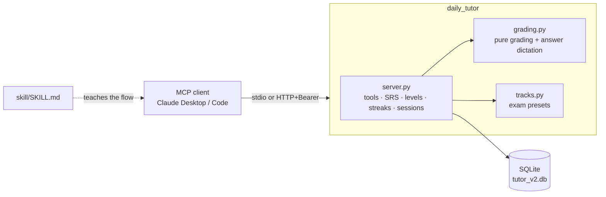

# Architecture

## Principle

> If an LLM can get it wrong, do it in code.

The server is the source of truth for **state, scheduling, grading, difficulty and answer positions**. The model is
used for what it is good at: writing a vivid scenario and explaining the result.

## Components

| Module | Responsibility |
|---|---|
| `server.py` | FastMCP app, auth, DB + migrations, all tools, spaced repetition, adaptive levels, streaks, sessions, materials |
| `grading.py` | Side-effect free: key validation, answer parsing, grading with partial credit, answer-position dictation |
| `tracks.py` | Certification objective lists used as subtopics |

## Question lifecycle

1. **Brief** (`get_next_question_brief`): the server chooses review vs new vs material, topic(s), subtopic, level,
   type, and **dictates the answer position**. The brief is stored (12 h TTL).
2. **Save** (`save_question`): validated against the stored brief (type, answer key), then checked for duplicate
   wording (Jaccard similarity ≥ 0.6) and a recently used concept. Any unanswered question is auto-skipped.
3. **Check** (`check_answer`): deterministic types are graded and recorded immediately; others return a rubric.
4. **Record** (`record_result`/internal): XP, streak (with freezes), daily goal, review scheduling, level adaptation
   and session progress are all updated in one transaction.

## Data model (SQLite)

| Table | Purpose |
|---|---|
| `topics` | Per-user topics: level, subtopics, `adaptive`, `level_since_qid` |
| `settings` | Enabled question types, daily XP goal, timezone |
| `questions` | Every question: type, concept, structured `answer_key` (JSON), status, links to review/session/material |
| `reviews` | Spaced-repetition queue: step on the 1/3/7/14/30 ladder, due date, `active`/`mastered` |
| `sessions` | Lessons of n questions |
| `materials`, `material_chunks` | User material split into ~1500-char chunks |
| `streaks` | current, best, last day, freezes |
| `activity` | XP per day |
| `briefs` | The pending brief per user (answer-position enforcement) |

Schema version lives in `PRAGMA user_version`; `MIGRATIONS` is an append-only list.

## Key design decisions

- **Dictated answer positions.** LLMs favour B/C and repeat concepts. The server picks the position and rejects
  anything else, which is verifiable in tests (`test_distribution_of_correct_positions_is_flat`).
- **Exact grading first.** `check_answer` is always the first call; the model only judges what code cannot.
- **Timezone-aware "today".** Streaks and goals use the user's IANA timezone, not server time.
- **Adaptive difficulty with a window.** A level changes only after 5 answers since the last change, avoiding
  oscillation. Manual levels restart the window; `auto_adjust=false` locks it.
- **Static bearer tokens.** Simple, auditable, works with Claude Code and header-capable clients. OAuth is on the roadmap.
- **SQLite.** One file, no ops. Fits a personal or small-team tutor; revisit for large multi-tenant hosting.
